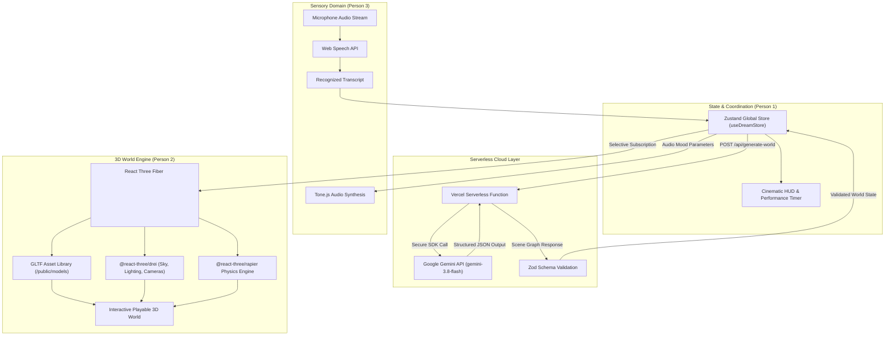
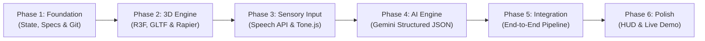

# Dream-to-Doom

> **"Speak Your Imagination. Watch It Become Reality."**

[](https://github.com/PRADUMNA-HJ/Dream_to_doom_hacathon)
[](https://react.dev/)
[](https://www.typescriptlang.org/)
[](https://vite.dev/)
[](https://tailwindcss.com/)
[](https://r3f.docs.pmnd.rs/)
[](https://github.com/pmndrs/react-three-rapier)
[](https://zustand.docs.pmnd.rs/)
[](https://ai.google.dev/)
[](https://tonejs.github.io/)
[](https://vercel.com/)

---

## 1. Project Introduction

**Dream-to-Doom** is an AI-powered, voice-driven 3D world generation experience built for an intensive 24-hour hackathon. Players simply speak naturally into their browser microphone to describe any world or scenario they imagine—from a neon-soaked cyberpunk citadel to a scorched volcanic wasteland. Instead of attempting to synthesize heavyweight 3D polygon meshes on the fly, our AI engine computes an optimized, typed **Scene Graph** in structured JSON format. The client-side engine immediately decodes this graph, orchestrating preloaded 3D GLTF assets, dynamic lighting rigs, environmental shaders, Rapier physics, and generative audio into an explorable, interactive 3D gaming world in real time.

* **Repository:** [https://github.com/PRADUMNA-HJ/Dream_to_doom_hacathon](https://github.com/PRADUMNA-HJ/Dream_to_doom_hacathon)
* **Architecture Style:** Client-Heavy Serverless (Vite SPA + Vercel Serverless AI Proxy)
* **Team Model:** 3-Person Domain Specialization (Integrator & AI Lead, 3D Graphics Lead, Sensory & Audio Lead)

---

## 2. The Problem

Creating playable 3D games from natural language prompts faces significant architectural bottlenecks when relying on conventional generative AI approaches:

1. **Mesh Synthesis Latency:** Generating raw 3D polygon geometry (via point clouds, NeRFs, or Gaussian splats) takes tens of seconds to several minutes per asset. This destroys the immediacy of conversational interaction.
2. **Lack of Semantic Game Mechanics:** Raw generative 3D meshes lack semantic game metadata—they do not come equipped with collision hulls, navigable colliders, interaction triggers, spawn anchors, or physics mass values.
3. **Severe Computational & Cost Overhead:** High-resolution 3D diffusion models require dedicated high-end GPU server clusters, which are cost-prohibitive and impractical for free-tier hackathon deployments.
4. **Visual & Art-Style Inconsistency:** Generating individual models in isolation results in mismatched artistic styles, textures, scale discrepancies, and broken visual coherence.
5. **Rigid Procedural Generators:** Classical rule-based procedural generation lacks semantic comprehension and cannot adapt dynamically to rich linguistic prompts like *"a haunted alien cathedral surrounded by low-gravity crystal pillars"*.

---

## 3. The Core Innovation: Scene Graph Generation

Dream-to-Doom circumvents generative latency entirely through **Semantic Scene Graph Generation**.

Rather than generating 3D vertices from scratch, we delegate semantic interpretation and scene composition to the AI. The AI functions as an instantaneous 3D level designer, translating the user's spoken words into a strictly typed, validated **Scene Graph (JSON)**. The client application then consumes this graph to dynamically instantiate, transform, light, and simulate an explorable environment using preloaded, optimized GLTF asset primitives.

```
Conventional Approach (Slow & Impractical):
Prompt ──> Heavy 3D Diffusion ──> Raw Unrigged Mesh (60s - 3min latency) ──> Broken Game Physics

Dream-to-Doom Approach (Instantaneous & Playable):
Speech Transcript ──> LLM Structured Scene Graph (JSON) ──> Client Instancing Engine (< 2s) ──> Fully Playable World
```

### Why Scene Graph Architecture Wins
* **Sub-Second Generation:** Transmitting a lightweight JSON description takes milliseconds over HTTP, keeping end-to-end world creation exceptionally fast.
* **Guaranteed Visual Quality:** Curated GLTF models ensure unified art direction, clean topology, and consistent lighting shaders.
* **Built-in Physics & Game Logic:** Every object node in the Scene Graph contains explicit collision types, physics mass, trigger types, and gameplay semantics.
* **Deterministic Validation:** Schema enforcement via **Zod** ensures that hallucinated or malformed properties are sanitized before reaching the 3D renderer.

### Representative Scene Graph Schema (Illustrative Baseline)

```json
{
  "worldId": "cyber_wasteland_01",
  "theme": "cyberpunk_ruins",
  "displayName": "Sector 7 Neon Slums",
  "environment": {
    "skyColor": "#0a0a1f",
    "fogColor": "#1a0826",
    "fogDensity": 0.035,
    "groundColor": "#12131a",
    "weather": "rain",
    "lighting": {
      "ambientColor": "#2d1b4e",
      "ambientIntensity": 0.4,
      "directionalColor": "#ff007f",
      "directionalIntensity": 1.2,
      "directionalPosition": [15, 25, 10]
    }
  },
  "playerSpawn": {
    "position": [0, 1.5, 0],
    "rotation": [0, 0, 0]
  },
  "audioMood": {
    "tempo": 128,
    "scale": "minor",
    "ambientPreset": "dystopian_drone",
    "reverbDecay": 3.5
  },
  "entities": [
    {
      "id": "pillar_alpha",
      "modelKey": "neon_pillar",
      "position": [-5, 0, -8],
      "rotation": [0, 0.78, 0],
      "scale": [1, 2.5, 1],
      "physics": {
        "bodyType": "fixed",
        "collider": "cuboid"
      },
      "interaction": {
        "type": "hazard",
        "effect": "damage",
        "label": "Overcharged Capacitor"
      }
    },
    {
      "id": "core_orb",
      "modelKey": "energy_crystal",
      "position": [4, 1.2, -6],
      "rotation": [0, 1.2, 0],
      "scale": [0.8, 0.8, 0.8],
      "physics": {
        "bodyType": "dynamic",
        "collider": "ball"
      },
      "interaction": {
        "type": "collectible",
        "effect": "score_boost",
        "label": "Plasma Core"
      }
    }
  ]
}
```

> [!NOTE]
> *Status Note:* The schema above represents the target contract for the project. Initial baseline iterations may support core lighting and transform nodes first, with weather particles and complex hazard interactions incrementally activated in subsequent phases.

---

## 4. Architecture & User Experience Flow

Dream-to-Doom is built as a **Client-Heavy Serverless Architecture**. There is no traditional persistent Node.js/Express server or application database. The frontend application runs directly in the client browser, while a single stateless **Vercel Serverless Function** acts as a secure, authenticated gateway to the Google Gemini API.

### End-to-End User Experience Lifecycle
1. **Entry:** The user navigates to the web application; the cinematic HUD displays a ready state.
2. **Audio Authorization:** The browser requests user permission for microphone input.
3. **Voice Prompting:** The user presses the voice trigger and speaks naturally (e.g., *"Generate a dark moon base with toxic craters"*).
4. **Speech-to-Text Conversion:** The browser-native **Web Speech API** decodes voice streams into a recognized text transcript.
5. **Secure Dispatch:** The frontend sends the transcript to the `/api/generate-world` serverless function.
6. **Semantic AI Interpretation:** Google Gemini (`gemini-3.8-flash`) processes the prompt with strict structured output constraints.
7. **JSON Scene Graph Generation:** Gemini returns a structured JSON Scene Graph.
8. **Schema Validation:** The payload is validated on the backend/client via **Zod** to ensure type safety.
9. **Global Store Update:** **Zustand** receives the validated world state and triggers selective subscriptions.
10. **3D Scene Mounting:** **React Three Fiber (R3F)** clears existing entities and constructs the new scene hierarchy.
11. **Visual Atmosphere Rendering:** **@react-three/drei** applies sky gradients, fog parameters, and lighting presets.
12. **Physics World Initialization:** **@react-three/rapier** sets up rigid bodies, fixed colliders, and collision listeners.
13. **Audio Synthesis Trigger:** **Tone.js** synthesizes ambient soundscapes and musical scale progressions matching the world's mood.
14. **Exploration & Play:** The user explores the generated 3D realm in first-person with real-time physics collisions.

### System Architecture Diagram



### Critical Architecture Boundary
> [!IMPORTANT]
> **Zero API Key Leakage Policy:** The client browser bundle never touches or stores the Google Gemini API key. All AI generation requests pass through the serverless function `/api/generate-world.ts`. Never define `VITE_GEMINI_API_KEY` in frontend environment files.

---

## 5. Technology Stack Breakdown

| Layer | Technology | Version / Spec | Primary Responsibility |
| :--- | :--- | :--- | :--- |
| **Framework & Build** | **React** | `^18.3.x` | Declarative UI and component lifecycle management |
| | **TypeScript** | `^5.x` | Static typing, contract enforcement, and developer safety |
| | **Vite** | `^5.x` | Ultra-fast HMR and optimized client bundling |
| | **Tailwind CSS** | `^3.4.x` | HUD styling, glassmorphism, responsive UI overlays |
| **3D Rendering** | **Three.js** | `^0.160.x` | Core WebGL scenegraph, rendering primitives, and matrices |
| | **React Three Fiber** | `^8.x` | Declarative Three.js component tree within React |
| | **@react-three/drei** | `^9.x` | Prebuilt helpers: `Sky`, `Sparkles`, `Environment`, `useGLTF`, `KeyboardControls` |
| **Physics** | **@react-three/rapier** | `^1.x` | WebAssembly-based physics: `RigidBody`, dynamic collisions, gravity, sensor fields |
| **State Management** | **Zustand** | `^4.5.x` | Centralized, decoupled reactive store bridging UI, 3D, Audio, and AI |
| **AI Generation** | **Google Gemini API** | `gemini-3.8-flash` | Natural language comprehension and structured JSON Scene Graph generation |
| | **@google/genai SDK** | Official SDK | Clean server-side integration with Gemini API |
| | **Zod** | `^3.x` | Runtime validation and sanitization of AI-generated JSON |
| **Sensory & Audio** | **Web Speech API** | Browser Native | High-speed, client-side speech-to-text recognition |
| | **Tone.js** | `^14.x` | Web Audio synthesizer, polyphonic chords, generative drones, dynamic SFX |
| **Hosting & Compute** | **Vercel** | Edge/Node Serverless | Static SPA asset CDN + secure serverless API execution |

---

## 6. The Live Demo Timer and Cinematic HUD

A standout feature for hackathon presentations is our **Cinematic HUD Overlay**, rendered in HTML/Tailwind directly above the WebGL `<Canvas>` viewport using absolute positioning and CSS pointer-events isolation.

### Features
* **High-Precision Live Stopwatch:** Displays real-time generation latency computed via `performance.now()` and animated smoothly using `requestAnimationFrame`.
* **State Machine Stage Indicators:** Visual progress nodes transitioning from Voice Input $\rightarrow$ AI Synthesis $\rightarrow$ Schema Validation $\rightarrow$ Asset Hydration $\rightarrow$ Physics Activation.
* **Terminal-Style Telemetry Stream:** Live status logs displaying exact timestamps for each stage completion.

```
[00:00.000] Voice recognition active... Listening for prompt.
[00:00.340] Speech captured: "A neon alien wasteland with toxic monoliths"
[00:00.410] Dispatching payload to Gemini serverless proxy...
[00:01.180] Scene Graph generated. Validating payload via Zod...
[00:01.210] Scene Graph verified (12 entities, Minor pentatonic audio scale).
[00:01.650] Hydrating GLTF primitives from cache...
[00:01.890] Rapier physics colliders initialized.
[00:01.950] World mounted. Timer stopped. Exploration active.
```

> [!NOTE]
> **Performance Honesty:** Timestamps shown above are illustrative. Real-world generation times depend on network latency and Gemini processing speed. Dream-to-Doom calculates all timer metrics dynamically using native performance timers without fabricated delays.

---

## 7. Project Folder Structure

The project follows a clean domain-driven architecture designed to prevent Git conflicts during the 24-hour sprint:

```
Dream_to_doom_hacathon/
├── api/                               # Vercel Serverless Function layer
│   └── generate-world.ts              # Gemini API proxy with structured JSON output
├── public/                            # Static assets served directly
│   ├── models/                        # Preloaded GLTF/GLB 3D assets (Kenny / Poly Pizza)
│   └── sfx/                           # Static audio samples (if needed)
├── src/
│   ├── shared/                        # Shared contracts & type definitions
│   │   └── worldSchema.ts             # Zod schema & TypeScript types for Scene Graph
│   ├── store/                         # Central state management
│   │   └── useDreamStore.ts           # Zustand global store & actions
│   ├── services/                      # Client-side API consumers
│   │   └── worldApi.ts                # HTTP client for invoking /api/generate-world
│   ├── world3d/                       # 3D Graphics domain (Person 2)
│   │   ├── SceneContainer.tsx         # R3F Canvas and environment wrapper
│   │   ├── DynamicWorld.tsx           # Iterates over entities and spawns 3D models
│   │   ├── ModelInstance.tsx          # GLTF asset loader with Rapier RigidBody
│   │   ├── PlayerController.tsx       # First-person character with Rapier physics
│   │   └── LightingRig.tsx            # Dynamic sun, ambient light, and fog
│   ├── sensory/                       # Sensory & Input domain (Person 3)
│   │   ├── SpeechController.ts        # Web Speech API recognition controller
│   │   ├── SoundEngine.ts             # Tone.js synths, soundscapes, and scale generators
│   │   └── useSpeechInput.ts          # React hook for microphone triggers
│   ├── components/                    # UI & HUD domain (Person 1)
│   │   ├── HudOverlay.tsx             # Cinematic glassmorphism overlay
│   │   ├── GenerationTimer.tsx        # performance.now() digital stopwatch
│   │   ├── VoiceButton.tsx            # Interactive mic record button
│   │   └── TerminalLogs.tsx           # Scrolling telemetry diagnostics
│   ├── App.tsx                        # Master layout combining HUD and 3D Canvas
│   ├── App.css
│   ├── index.css                      # Tailwind CSS root imports
│   └── main.tsx                       # React application entry point
├── .env.example                       # Documented environment variable template
├── .gitignore                         # Git exclusion rules (node_modules, .env, dist)
├── package.json                       # Project dependencies and build scripts
├── tsconfig.json                      # TypeScript compiler settings
├── vite.config.ts                     # Vite build configuration
└── README.md                          # Comprehensive project documentation
```

---

## 8. Global State & Communication Contract

To eliminate Git merge conflicts and enforce strict decoupling, all domains communicate exclusively through the **Zustand** global store (`useDreamStore`). 

* **Person 1 (Integrator):** Maintains the store implementation and executes state transitions.
* **Person 2 (3D Lead):** Selects `world` and `generationStatus` to spawn objects and initialize physics.
* **Person 3 (Sensory Lead):** Dispatches updated `transcript` and observes `world.audioMood` to alter Tone.js compositions.

### Core State Contract (`src/shared/worldSchema.ts`)

```typescript
import { z } from 'zod';

// Entity Schema: Represents individual objects in 3D space
export const EntitySchema = z.object({
  id: z.string(),
  modelKey: z.string(),
  position: z.tuple([z.number(), z.number(), z.number()]),
  rotation: z.tuple([z.number(), z.number(), z.number()]).default([0, 0, 0]),
  scale: z.tuple([z.number(), z.number(), z.number()]).default([1, 1, 1]),
  physics: z.object({
    bodyType: z.enum(['fixed', 'dynamic', 'sensor']).default('fixed'),
    collider: z.enum(['cuboid', 'ball', 'hull']).default('cuboid'),
    mass: z.number().optional().default(1),
  }),
  interaction: z.object({
    type: z.enum(['none', 'collectible', 'hazard', 'portal']).default('none'),
    effect: z.string().optional(),
    label: z.string().optional(),
  }).optional(),
});

// Scene Graph Schema: Complete world blueprint generated by AI
export const WorldSceneGraphSchema = z.object({
  worldId: z.string(),
  theme: z.string(),
  displayName: z.string(),
  environment: z.object({
    skyColor: z.string().default('#0d1117'),
    groundColor: z.string().default('#161b22'),
    fogColor: z.string().default('#0d1117'),
    fogDensity: z.number().default(0.02),
    weather: z.enum(['clear', 'fog', 'rain', 'snow']).default('clear'),
    lighting: z.object({
      ambientColor: z.string().default('#ffffff'),
      ambientIntensity: z.number().default(0.5),
      directionalColor: z.string().default('#ffd580'),
      directionalIntensity: z.number().default(1.0),
      directionalPosition: z.tuple([z.number(), z.number(), z.number()]).default([10, 20, 10]),
    }),
  }),
  playerSpawn: z.object({
    position: z.tuple([z.number(), z.number(), z.number()]).default([0, 1, 0]),
    rotation: z.tuple([z.number(), z.number(), z.number()]).default([0, 0, 0]),
  }),
  audioMood: z.object({
    tempo: z.number().default(120),
    scale: z.enum(['major', 'minor', 'pentatonic', 'diminished']).default('minor'),
    ambientPreset: z.string().default('ethereal_drone'),
    reverbDecay: z.number().default(2.5),
  }),
  entities: z.array(EntitySchema).max(30), // Bound entity count for peak 60 FPS
});

export type WorldSceneGraph = z.infer<typeof WorldSceneGraphSchema>;
export type Entity = z.infer<typeof EntitySchema>;
```

### Store Interface (`src/store/useDreamStore.ts`)

```typescript
export type GenerationStatus = 'idle' | 'listening' | 'generating' | 'hydrating' | 'ready' | 'error';

export interface DreamState {
  // State slices
  transcript: string;
  world: WorldSceneGraph | null;
  generationStatus: GenerationStatus;
  generationError: string | null;
  activeEvents: string[];
  requestId: string | null;
  performanceMetrics: {
    voiceDurationMs: number;
    aiDurationMs: number;
    renderDurationMs: number;
    totalLatencyMs: number;
  };

  // Actions
  setTranscript: (transcript: string) => void;
  setGenerationStatus: (status: GenerationStatus) => void;
  setWorld: (world: WorldSceneGraph) => void;
  setError: (error: string | null) => void;
  addEvent: (event: string) => void;
  clearEvents: () => void;
  resetSession: () => void;
}
```

---

## 9. Team Roles & Workload Distribution

To prevent Git merge conflicts and maintain balanced progress, the team operates under strict domain boundaries:

| Member | Domain & Role | Core Responsibilities | Primary Directories |
| :--- | :--- | :--- | :--- |
| **Person 1** | **Integrator & AI Lead** *(Repo Owner)* | Setting up the Vite repository, crafting Tailwind HUD components, managing the Zustand store, implementing the Gemini API serverless function, validating JSON with Zod, and conducting all Git PR merges. | `api/`<br/>`src/store/`<br/>`src/shared/`<br/>`src/components/`<br/>`src/services/` |
| **Person 2** | **3D & Graphics Lead** | Building the R3F `<Canvas>` scene, handling GLTF model instancing, configuring lighting and camera rigs, establishing Rapier physics colliders, and implementing character navigation. | `src/world3d/`<br/>`public/models/` |
| **Person 3** | **Sensory & Audio Lead** | Managing browser microphone access, Web Speech API speech-to-text recognition, handling fallbacks, setting up Tone.js synthesis, and triggering soundscapes keyed to the AI's audio mood parameters. | `src/sensory/`<br/>`public/sfx/` |

---

## 10. Getting Started

### Prerequisites
* **Node.js:** `v18.18.0` or higher (LTS recommended)
* **Package Manager:** `npm` (v9+) or `pnpm`
* **Browser:** Modern Chromium-based browser (Google Chrome, Brave, Microsoft Edge) recommended for native Web Speech API recognition and WebGL2 hardware acceleration.
* **Vercel CLI** *(optional, for local serverless testing)*: `npm i -g vercel`

### Installation & Local Setup

```bash
# 1. Clone the repository
git clone https://github.com/PRADUMNA-HJ/Dream_to_doom_hacathon.git

# 2. Enter project folder
cd Dream_to_doom_hacathon

# 3. Install dependencies
npm install

# 4. Configure local environment variables
cp .env.example .env.local

# 5. Start the frontend development server
npm run dev
```

### Full-Stack Local Development with Vercel Serverless
Because the Gemini AI call executes within `/api/generate-world.ts`, you can test both the Vite frontend and the serverless API simultaneously using the Vercel CLI:

```bash
# Run both Vite and Serverless Functions locally
vercel dev
```

### Standard Scripts
* `npm run dev` — Launches Vite local dev server with Hot Module Replacement (HMR).
* `npm run build` — Compiles TypeScript and builds optimized production bundles into `dist/`.
* `npm run preview` — Locally previews the production build.

---

## 11. Environment Variables

Create a `.env.local` file in the project root. **Never commit real credentials to GitHub.**

```ini
# Google Gemini API Configuration (Used exclusively inside /api serverless functions)
GEMINI_API_KEY=your_gemini_api_key_here

# Active Model Identifier (Defaults to gemini-3.8-flash for speed and structured outputs)
GEMINI_MODEL=gemini-3.8-flash
```

> [!WARNING]
> Do NOT prefix secrets with `VITE_` (e.g., `VITE_GEMINI_API_KEY`). Any variable prefixed with `VITE_` is automatically bundled into public client-side JavaScript code and exposed to anyone inspecting browser network traffic.

---

## 12. Performance & Latency Strategy

To deliver an instantaneous, 60 FPS experience within hackathon time constraints, Dream-to-Doom implements several deliberate optimizations:

1. **Lightweight JSON Generation:** Transmitting 2 KB of structured JSON requires a fraction of the compute and bandwidth needed for megabytes of 3D polygon meshes.
2. **Preloaded Asset Library:** Curated, low-poly GLTF primitives (`tree_lowpoly`, `neon_pillar`, `rock_formation`, `crystal_core`) reside in `/public/models/` and are preloaded into GPU memory via `useGLTF.preload()`.
3. **Selective Zustand Subscriptions:** Components subscribe exclusively to the state slices they require (e.g., `<SceneContainer />` only re-renders when `world` changes), preventing canvas teardowns during HUD updates.
4. **Isolated WebGL Canvas:** The R3F `<Canvas>` operates in its own rendering loop independent of React's DOM reconciliation.
5. **Entity Clamping:** The Zod schema enforces `.max(30)` entities to prevent physics slowdowns and preserve stable 60 FPS performance on mid-tier hardware.
6. **In-Browser Audio Synthesis:** Tone.js synthesizes audio dynamically on the client's Web Audio thread, requiring zero audio streaming bandwidth.

---

## 13. Security & Reliability

* **Server-Side API Key Isolation:** All requests to Google Gemini are mediated by a Vercel Serverless Function running in an isolated execution environment.
* **Zod Runtime Validation:** Every AI response is validated against `WorldSceneGraphSchema`. Hallucinated or truncated JSON payloads trigger fallback world definitions rather than crashing the client.
* **Strict Asset Allowlists:** The frontend maps `modelKey` strings to an explicit internal registry. Unrecognized model keys automatically fall back to generic geometric placeholders.
* **Race Condition Mitigation:** Generation dispatches generate a unique `requestId`. If a subsequent user request completes first, stale responses are gracefully dropped.
* **Speech Fallback Support:** In environments where microphone permissions are denied or unsupported, a manual text-entry mode allows typing world descriptions.

---

## 14. Development Roadmap



* [x] **Phase 1: Project Foundation & Contracts (Complete - V_1)**
  * [x] Initialize Git repository and domain workflow.
  * [x] Define TypeScript interfaces and Zod Scene Graph schemas.
  * [x] Author comprehensive architecture documentation.
* [x] **AI Generation Engine (Person 1 - Phase 2 Complete)**
  * [x] Implement serverless `/api/generate-world.ts` with `@google/genai`.
  * [x] Configure structured JSON system instructions with Gemini (`gemini-3.8-flash`).
  * [x] Connect client `worldApi.ts` with Zod runtime validation and error handling.
  * [x] Implement concurrency request-ID protection in generation controller.
* [x] **Phase 3: Complete Application Integration & Final Demo (Phase 3 Complete)**
  * [x] Integrate React Three Fiber `<Canvas>` with Rapier physics engine.
  * [x] Implement procedural 3D asset registry for all 10 allowlisted primitives.
  * [x] Integrate Web Speech API speech controller with browser capability detection and fallback.
  * [x] Integrate Tone.js polyphonic audio engine with mood scaling and game event SFX.
  * [x] Build futuristic Generation HUD with monotonic `performance.now()` stopwatch timer.
  * [x] Implement multi-consumer Game Event Bus avoiding cross-consumer event loss.
  * [x] Create seamless world transition lifecycle and loading overlays.
* [ ] **Final Polish & Rehearsal**
  * [ ] Add custom author-modeled GLTF assets to `/public/models/`.
  * [ ] Rehearse live 3-step demo sequence with judges.

---

## 15. Browser Compatibility & Troubleshooting

| Issue | Root Cause | Resolution |
| :--- | :--- | :--- |
| **Speech recognition not starting** | Browser does not support Web Speech API natively (e.g. Firefox) or mic blocked. | Use Google Chrome or Edge. Ensure microphone permission is granted in browser settings (`chrome://settings/content/microphone`). Use text input fallback. |
| **Web Audio silent on initial load** | Modern browsers block audio context until the user performs an explicit interaction. | Trigger `Tone.start()` on the first user click or microphone button press. |
| **GLTF model fails to load** | Model path incorrect or file missing from `/public/models/`. | Verify file exists at `public/models/{modelKey}.glb`. Reference assets using root relative paths (`/models/{modelKey}.glb`). |
| **500 error from `/api/generate-world`** | Missing or invalid `GEMINI_API_KEY`. | Verify `.env.local` exists with valid key. In Vercel deployment, ensure key is added under Project Settings $\rightarrow$ Environment Variables. |
| **WebGL context lost / Low FPS** | Too many active physics bodies or high polygon models. | Keep total scene entity count under 30. Optimize GLTF meshes using gltf-pipeline or Draco compression. |

---

## 16. Contributing & Git Workflow

To maintain clean history and avoid merge conflicts, all team members work on isolated feature branches and merge into `main` exclusively through Pull Requests reviewed by the Integrator (Person 1).

### Branching Convention
* `main` — Production-ready baseline (maintained by Person 1).
* `feature/3d-world` — Person 2 (3D Graphics & Physics).
* `feature/sensory-input` — Person 3 (Voice & Tone.js Audio).
* `feature/ai-integration` — Person 1 (Gemini API & Serverless).

### Step-by-Step Developer Workflow

```bash
# 1. Fetch latest changes from main
git checkout main
git pull origin main

# 2. Create your dedicated feature branch
git switch -c feature/your-domain-name

# 3. Work on your domain files, then commit with clean messages
git add .
git commit -m "feat(3d): implement Rapier dynamic entity instancing"

# 4. Push branch to GitHub
git push -u origin feature/your-domain-name

# 5. Open a Pull Request on GitHub targeting 'main'
```

> [!CAUTION]
> Never push directly to `main`. Never modify another teammate's domain folder without prior alignment on the Zustand shared contract.

---

## 17. Acknowledgments & Official References

* [React Documentation](https://react.dev/)
* [Vite Documentation](https://vite.dev/)
* [Three.js Documentation](https://threejs.org/)
* [React Three Fiber (R3F) Documentation](https://r3f.docs.pmnd.rs/)
* [Drei GitHub Repository](https://github.com/pmndrs/drei)
* [Rapier Physics Engine](https://github.com/pmndrs/react-three-rapier)
* [Zustand Documentation](https://zustand.docs.pmnd.rs/)
* [Google Gemini API Documentation](https://ai.google.dev/gemini-api/docs)
* [Google Gen AI SDK](https://github.com/googleapis/js-genai)
* [Tone.js Documentation](https://tonejs.github.io/)
* [Web Speech API (MDN)](https://developer.mozilla.org/en-US/docs/Web/API/Web_Speech_API)
* [Vercel Functions Documentation](https://vercel.com/docs/functions)
* [Zod Documentation](https://zod.dev/)
* Asset Resources: [Kenney.nl](https://kenney.nl/assets) & [Poly Pizza](https://poly.pizza/) (CC0 / Attribution licenses)
