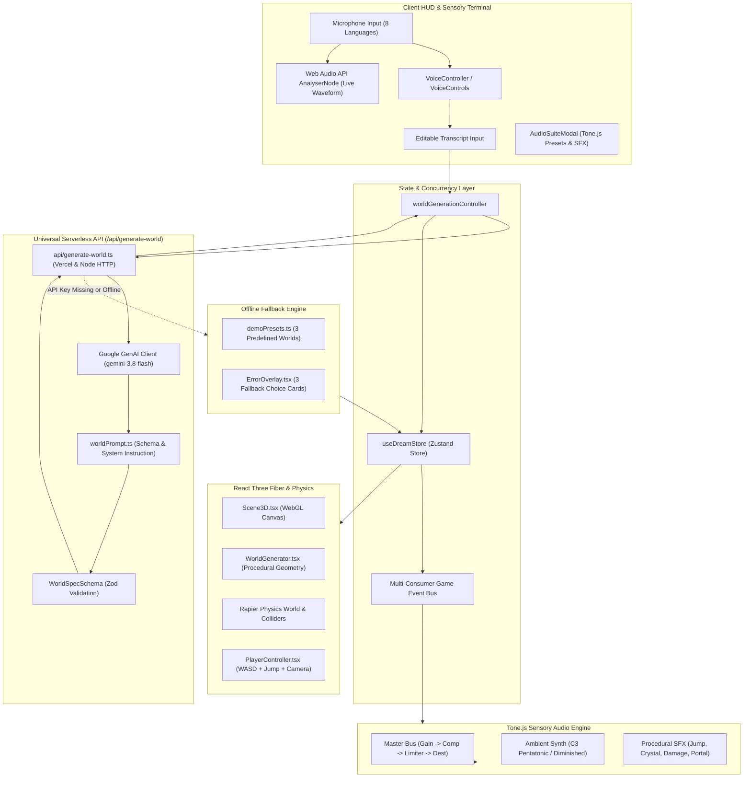

# Dream-to-Doom

> **"Speak Your Imagination. Watch It Become Playable Reality in Real Time."**

[](https://github.com/PRADUMNA-HJ/Dream_to_doom_hacathon)
[](https://react.dev/)
[](https://www.typescriptlang.org/)
[](https://vite.dev/)
[](https://tailwindcss.com/)
[](https://r3f.docs.pmnd.rs/)
[](https://github.com/pmndrs/react-three-rapier)
[](https://zustand.docs.pmnd.rs/)
[](https://ai.google.dev/)
[](https://tonejs.github.io/)
[](https://vercel.com/)
[](https://github.com/PRADUMNA-HJ/Dream_to_doom_hacathon)
[](https://github.com/PRADUMNA-HJ/Dream_to_doom_hacathon)

---

## 1. Project Overview

**Dream-to-Doom** is an AI-powered, multilingual voice-to-playable-3D game engine built during an intensive 24-hour hackathon. Players simply speak an imagination prompt—in English or any of 7 regional Indian languages—or type a description of the world they envision. 

Instead of waiting minutes for heavy 3D diffusion models to generate unrigged meshes, Dream-to-Doom uses **Google Gemini 3.8 Flash** via a secure serverless gateway to compute a deterministic, strictly validated **Scene Graph**. The browser client instantly hydrates this contract into an explorable 3D world with third-person character movement, Rapier rigid-body physics, collectible crystals, hazard entities, dimensional portals, and adaptive Tone.js procedural music in **under 2 seconds**.

* **Repository:** [https://github.com/PRADUMNA-HJ/Dream_to_doom_hacathon](https://github.com/PRADUMNA-HJ/Dream_to_doom_hacathon)
* **Architecture:** Client-Heavy Serverless (Vite SPA + Vercel Serverless Functions)
* **Live Local Address:** `http://localhost:3000/`

---

## 2. Problem Statement

Conventional generative AI approaches face critical roadblocks when attempting to generate playable 3D games from natural language:

1. **Diffusion Latency (30s – 120s):** Synthesizing 3D vertices, NeRFs, or Gaussian splats takes tens of seconds to minutes per object, destroying real-time conversational playability.
2. **Missing Physics & Gameplay Semantics:** Raw generative 3D meshes lack collision hulls, ground anchors, collectible tags, trigger zones, and rigid bodies.
3. **Heavy Compute Costs:** 3D diffusion requires expensive GPU clusters (A100/H100) that cannot run within browser constraints or free-tier serverless limits.
4. **Artistic Incoherence:** Generating assets independently creates mismatched art styles, polygon scales, and broken lighting.

---

## 3. The Solution: Semantic Scene Graph Generation

Dream-to-Doom circumvents generative latency by separating **semantic level design** from **client-side asset rendering**:

```
Traditional 3D Diffusion (Slow & Impractical for Web Games):
Natural Prompt ──> 3D Diffusion GPU Cluster ──> Heavy Unrigged Mesh (60s - 3min) ──> Broken Physics

Dream-to-Doom Architecture (Instantaneous & Playable):
Spoken Voice ──> Gemini Flash (JSON Scene Graph) ──> Zod Validator ──> R3F Engine (< 2s) ──> Playable 3D Game
```

* **Instantaneous:** Transmitting a ~2KB JSON Scene Graph over edge serverless routes takes ~300ms–500ms.
* **Deterministic Contract:** Validated via **Zod** (`WorldSpecSchema`) to ensure all coordinates, scales, and entity counts fall within safe bounds.
* **Guaranteed 60 FPS:** Optimized low-poly procedural assets and instanced geometries sustain smooth rendering on standard laptops and mobile devices.
* **Built-in Physics:** Every entity possesses an explicit Rapier physics hull (`fixed`, `dynamic`, or `sensor`).

---

## 4. Key Features

- **🎬 10-Second Cinematic Video Showcase:** When you input an idea, the camera automatically performs an ultra-smooth, 3-act drone fly-through across the generated 3D world (0.0s to 10.0s), with cinema letterboxing, live timecode, scrubber seek bar, replay, and shot jump controls.
- **🔄 Dual Mode (Video Showcase $\leftrightarrow$ Interactive Play):** Instant toggle between the 10-second automated video experience and third-person interactive gameplay (WASD + jump).
- **⚡ Offline Procedural Prompt Synthesizer:** Instantly creates a customized 3D world directly matching your prompt keywords even without a Gemini API key or internet connection.
- **Multilingual Speech Recognition:** Real-time speech-to-text supporting 8 languages with native scripts.
- **Web Audio Live Waveform Visualizer:** Real-time microphone audio frequency analysis via `AudioContext` and `AnalyserNode`.
- **Serverless AI Gateway:** Universal `/api/generate-world` serverless function with zero client-side credential exposure.
- **Strict Zod Runtime Validation:** Bounds checking on all positions, scales, entity limits (max 28), and unique IDs.
- **Optimistic Concurrency Guards:** Request-ID tracking prevents outdated late responses from corrupting the active scene.
- **3D Character Controller:** Smooth WASD + Arrow keys, sprint (Shift), ground-detection jump (Space), and third-person camera following.
- **Interactive Gameplay Elements:** Collectible crystals (+10 score, chime SFX), hazard drones (-15 health, damage cooldown, pink noise SFX), and dimensional teleportation portals.
- **Guaranteed Offline Demo Mode:** 3 pre-compiled 3D worlds (Enchanted Forest, Cyberpunk Rooftop, Floating Islands) with visible `[Offline Demo Mode]` badge.
- **Tone.js Sensory Audio Engine:** C3 root note (~130.81 Hz), Major Pentatonic scale for Dream moods, Diminished Octatonic scale for Doom moods, 6 ambient presets, and 4 procedural SFX.
- **Mobile Touch Controls:** On-screen virtual D-Pad and Jump button for mobile viewports.
- **Architecture Blueprint Modal:** Interactive in-app technical reference detailing the 8-stage pipeline, trade-off comparisons, and collision mathematics.

---

## 5. Technology Stack

| Layer | Technologies | Purpose |
| :--- | :--- | :--- |
| **Frontend Framework** | React 18, TypeScript 5.6, Vite 5 | Reactive UI, typed state, fast HMR bundling |
| **Styling & Design** | Tailwind CSS 4, Cyberpunk Theme | Futuristic glassmorphic HUD overlays, responsive layout |
| **3D Graphics Engine** | Three.js 0.169, React Three Fiber 8.17, Drei | WebGL canvas, lighting rigs, camera tracking, procedural meshes |
| **Physics Simulation** | `@react-three/rapier` 1.5 (Rapier WASM) | Rigid bodies, capsule colliders, sensor triggers, collision matrix |
| **AI Generation** | Google Gen AI SDK (`@google/genai`), Gemini 3.8 Flash | Structured JSON scene graph synthesis via system instructions |
| **Contract Validation** | Zod 3.23 | Strict schema enforcement, coordinate bounds, entity sanitization |
| **State Management** | Zustand 4.5 | Atomic state store, concurrency locks, telemetry event logging |
| **Sensory Audio** | Tone.js 14.8 | Polyphonic synthesis, master compression/limiting bus, procedural SFX |
| **Voice Processing** | Web Speech API, Web Audio API (`AnalyserNode`) | Speech-to-text, live frequency visualizer, transcript editing |
| **Serverless Backend** | Vercel Serverless Functions (`api/generate-world.ts`) | Edge proxy protecting `GEMINI_API_KEY`, Node HTTP stream handling |
| **Testing** | Vitest 2.1 | 114 unit and integration tests across 15 test suites |

---

## 6. System Architecture



---

## 7. Voice-to-World Pipeline (8 Stages)

1. **Speech Input:** Captures microphone audio stream across 8 supported languages. Analyzed live via `AnalyserNode`.
2. **Speech Recognition:** Web Speech API converts audio to text with streaming interim transcripts and confidence readouts.
3. **Gemini API Gateway:** Dispatched to serverless `/api/generate-world` calling `gemini-3.8-flash`. API keys are server-only.
4. **JSON Response:** Gemini returns typed scene graph JSON conforming to the OpenAPI 3.0 specification.
5. **Zod Validation:** `WorldSpecSchema.safeParse()` sanitizes bounds, clamps positions, and validates entity constraints.
6. **Zustand Synchronization:** Store increments `worldRevision`, applies optimistic concurrency locks, and logs telemetry.
7. **React Three Fiber Hydration:** R3F mounts procedural meshes, instantiates lighting, sets sky colors, and binds Rapier colliders.
8. **Generated 3D World:** Third-person player spawns, camera follows, crystals sparkle, hazards patrol, and Tone.js modulates ambient chords.

---

## 8. AI Integration & Scene Graph Contract

### Server-Side Environment Protection
The Gemini API key is never bundled in frontend code. It is accessed exclusively in serverless routes via `process.env.GEMINI_API_KEY`.

### Scene Graph Specification (Zod Schema)
```typescript
export const WorldSpecSchema = z.object({
  id: z.string().min(1),
  title: z.string().min(1),
  description: z.string().min(1),
  biome: z.enum(['enchanted_forest', 'floating_islands', 'desert_ruins', 'crystal_cave', 'dark_castle', 'cosmic_void']),
  mood: z.enum(['dream', 'doom', 'surreal', 'mystery']),
  audioMood: z.enum(['calm', 'mystical', 'tense', 'chaotic']),
  environment: z.object({
    skyColor: HexColorSchema,
    fogColor: HexColorSchema,
    groundColor: HexColorSchema,
    fogDensity: z.number().min(0).max(0.2),
  }),
  lighting: z.object({
    ambientIntensity: z.number().min(0).max(5),
    directionalIntensity: z.number().min(0).max(10),
    directionalColor: HexColorSchema,
  }),
  weather: z.object({
    type: z.enum(['clear', 'rain', 'snow', 'fog']),
    intensity: z.number().min(0).max(1),
  }),
  spawnPoint: Coordinate3DSchema,
  entities: z.array(WorldEntitySchema).max(28),
});
```

---

## 9. 3D Gameplay Mechanics

- **Movement:** `W`, `A`, `S`, `D` or Arrow keys (normalized diagonal velocity).
- **Sprint:** Hold `Shift` for boost speed (from 7.0 to 10.5 m/s).
- **Jump:** `Spacebar` triggers vertical impulse (+8.0 m/s) with ground-contact raycast detection preventing infinite double-jumping.
- **Collectibles:** Floating glowing crystals (+10 points each, sparkling chime SFX, instant score HUD update).
- **Hazards:** Guardian drones deal -15 damage on contact with a strict 1200ms rate-limit cooldown and pink noise impact SFX.
- **Portals:** Step into the portal ring to trigger a dimensional warp flash and instant teleportation.
- **Boundaries:** Terrain $100\times100\text{m}$ bounds; falling beneath $y = -10$ auto-respawns player safely.
- **Mobile Controls:** On-screen D-Pad and Jump button for touchscreens.

---

## 10. Tone.js Sensory Audio Engine

All synthesizers route through a master bus: `Gain -> Compressor -> Limiter -> Tone.Destination`.

### Adaptive Musical Scales
- **Root Pitch:** C3 (~130.81 Hz).
- **Dream Profile (Calm / Mystical):** C3 Major Pentatonic (`[0, 2, 4, 7, 9]` semitones: 130.81 Hz, 146.83 Hz, 164.81 Hz, 195.99 Hz, 220.00 Hz).
- **Doom Profile (Tense / Chaotic):** Half-Whole Diminished Octatonic (`[0, 1, 3, 4, 6, 7, 9, 10]` semitones).

### 6 Ambient Presets (Audio Suite Modal)
1. `nature_breeze` — Calm acoustic lowpass pads.
2. `ethereal_drone` — Shimmering reverb-heavy mystical sequence.
3. `dystopian_drone` — Low resonant minor chords with detuned harmonics.
4. `cyber_ambience` — Fast arpeggiated filtered square wave pulses.
5. `volcanic_rumble` — Low-frequency sub rumble with pink noise textures.
6. `void_silence` — Minimal atmospheric room presence.

### 4 Procedural Sound Effects
| Game Event | Synthesizer | Frequency Envelope |
| :--- | :--- | :--- |
| `player-jump` | Triangle Synth | G3 $\to$ D4 exponential pitch ramp (150ms) |
| `item-collected` | Triangle Synth | E5 (32n) $\to$ B5 (16n) bright chime |
| `player-damaged` | Pink Noise Synth | Short burst (16n) through lowpass filter |
| `portal-entered` | Triangle Synth | A3 $\to$ E5 sweeping upward glissando |

---

## 11. Supported Languages

| Code | Language | Native Label |
| :--- | :--- | :--- |
| `en-US` | English (US) | English (United States) |
| `ta-IN` | Tamil (India) | தமிழ் (இந்தியா) |
| `kn-IN` | Kannada (India) | ಕನ್ನಡ (ಭಾರತ) |
| `te-IN` | Telugu (India) | తెలుగు (భారతదేశం) |
| `mr-IN` | Marathi (India) | मराठी (भारत) |
| `bn-IN` | Bengali (India) | বাংলা (ভারত) |
| `ml-IN` | Malayalam (India) | മലയാളം (ഇന്ത്യ) |
| `hi-IN` | Hindi (India) | हिन्दी (भारत) |

---

## 12. Predefined Offline Demo Worlds

For guaranteed demonstration reliability without an API key or internet access:

1. **🌿 Emerald Grove Sanctuary (`world-dev-baseline`):** Serene ancient glade, glowing trees, stone platforms, 5 crystals (+10 score), portal, and hazard drone.
2. **🏙️ Neo-Veridia Cyber Rooftop (`world-preset-cyberpunk-rooftop`):** Dystopian rooftop in neon rain, helipad, catwalks, observation tower, neon lamps, 4 crystals, and security drones.
3. **☁️ Aetheria Floating Archipelago (`world-preset-floating-islands`):** Surreal floating cloud islands, ethereal trees, celestial shrine, 4 crystals, and sky portal.

*When offline fallback is active, an animated `[Offline Demo Mode]` badge is prominently displayed in the header and status panels.*

---

## 13. Installation & Local Development

### Prerequisites
- Node.js 18.0+ or Node.js 20.0+
- npm or pnpm
- Google Chrome or Microsoft Edge (for Web Speech API)

### Steps

```bash
# 1. Clone repository
git clone https://github.com/PRADUMNA-HJ/Dream_to_doom_hacathon.git
cd Dream_to_doom_hacathon

# 2. Install dependencies
npm install

# 3. Configure environment variables (optional for offline demo mode)
cp .env.example .env.local
# Edit .env.local and add your GEMINI_API_KEY

# 4. Start local development server
npm run dev

# 5. Open in browser
# Navigate to http://localhost:3000/
```

---

## 14. Testing & Quality Assurance

```bash
# Run complete test suite (114 unit and integration tests across 15 suites)
npm test

# Run TypeScript strict type verification
npx tsc --noEmit

# Run production build
npm run build
```

---

## 15. Production Deployment

The project is pre-configured for one-click deployment on **Vercel**:

1. Push your code to GitHub.
2. Import the repository into the [Vercel Dashboard](https://vercel.com/new).
3. Framework Preset: **Vite** (auto-detected via `vercel.json`).
4. Output Directory: **`dist`**.
5. Under **Environment Variables**, add:
   - `GEMINI_API_KEY` = your secret Google Gemini API key.
   - `GEMINI_MODEL` = `gemini-3.8-flash`
6. Click **Deploy**. Vercel automatically deploys the frontend and the `/api/generate-world` serverless function.

---

## 16. Contributors & Team Specialization

Developed during an intensive 24-hour hackathon by:

- **Person 1 — Integrator & AI Lead:** Frontend foundation, Vercel Serverless Function, Google Gen AI SDK integration, Zod Scene Graph schemas, Zustand global store, concurrency locks, and Tailwind HUD.
- **Person 2 — 3D & Graphics Lead:** React Three Fiber canvas, Rapier rigid bodies, Kinematic character controller, camera follow, and procedural 3D asset taxonomy.
- **Person 3 — Sensory & Audio Lead:** Web Speech API multilingual voice input (8 languages), Web Audio API waveform visualizer, Tone.js polyphonic audio engine, adaptive mood scales, and procedural SFX.
