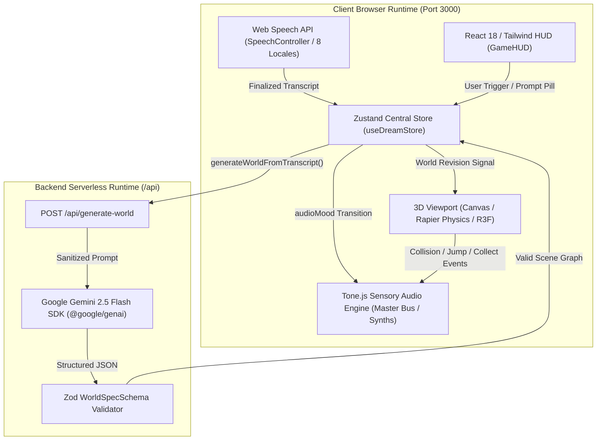

# Dream-to-Doom — Phase 1: Complete Codebase Audit & Integration Foundation Report

**Document Version:** 1.0.0  
**Project:** Dream-to-Doom — Voice-to-Playable-3D  
**Repository:** `https://github.com/PRADUMNA-HJ/Dream_to_doom_hacathon.git`  
**Active Branch:** `main`  
**Audit Lead:** Principal Integration Engineer & Systems Architect (Person 1)  
**Date:** 2026-11-15  

---

## 1. Executive Summary

This report establishes the verified baseline for the **Dream-to-Doom** project following the consolidation and merge of all three team contributors' implementations into the `main` branch. 

Dream-to-Doom transforms natural language voice transcripts into fully interactive, playable 3D worlds governed by Rapier physics and dynamic Tone.js audio in under 3 seconds. The codebase currently comprises **100 source and configuration files**, with **92/92 automated Vitest tests passing**, zero TypeScript compilation errors (`tsc --noEmit`), and a production bundle compiled via Vite (`3.5MB` raw, `1.15MB` gzip).

All three contributors' domains—Person 1 (AI Generation, Zod Schema, Serverless Functions, Zustand Store, HUD), Person 2 (React Three Fiber, Rapier Physics, Asset Taxonomy), and Person 3 (Web Speech API, Tone.js Audio Engine, Multi-language Support)—are integrated and running locally on `http://localhost:3000`.

---

## 2. Repository Architecture



---

## 3. Important Directory Structure

```
Dream_to_dream/
├── api/                                # Backend Serverless AI Generation Layer
│   ├── _lib/
│   │   ├── apiErrors.ts                # Structured API error envelopes & factory
│   │   ├── geminiClient.ts             # Google GenAI SDK client singleton
│   │   ├── worldGeneration.ts          # Core Gemini LLM call & Zod validation
│   │   ├── worldGeneration.test.ts     # Generation logic unit tests
│   │   ├── worldPrompt.ts              # System prompt, asset constraints & schema
│   │   └── worldPrompt.test.ts         # Prompt sanitation & injection defense tests
│   ├── generate-world.ts               # Vercel Serverless Function entry point
│   └── generate-world.test.ts          # HTTP handler integration tests
├── docs/                               # Architecture, audit & integration contracts
├── public/
│   └── models/                         # GLTF/GLB 3D asset directory
├── src/
│   ├── app/
│   │   ├── App.tsx                     # Top-level React application root
│   │   ├── GameOrchestrator.tsx        # Coordinates 3D Scene, Audio events & HUD
│   │   └── integration.test.ts         # End-to-end integration test suite
│   ├── components/
│   │   ├── feedback/                   # ErrorBoundary, ErrorOverlay, GameOverOverlay
│   │   ├── hud/                        # TopNav, VoiceControls, GenerationTimer, Modals
│   │   └── layout/                     # Header, IntegrationSurface
│   ├── sensory/                        # Person 3 Audio & Speech Domain
│   │   ├── audio/                      # audioManager, ambientAudio, soundEffects
│   │   ├── components/                 # AudioControls, VoiceController (Cyber Terminal)
│   │   ├── hooks/                      # useSpeechRecognition, useGameAudioEvents
│   │   ├── types/                      # audio.types.ts, speech.types.ts (8 languages)
│   │   ├── SoundEngine.ts              # Sensory SoundEngine facade
│   │   └── SpeechController.ts         # Web Speech API singleton
│   ├── services/                       # Frontend API client & orchestrating controller
│   │   ├── worldApi.ts                 # Typed fetch client with Zod parse & aborts
│   │   └── worldGenerationController.ts# Zustand generation dispatcher & mutex
│   ├── shared/
│   │   ├── constants/                  # Asset allowlist, default mock world, presets
│   │   ├── events/                     # Multi-consumer typed EventBus
│   │   └── schemas/                    # Zod WorldSpecSchema & validation
│   ├── store/
│   │   └── useDreamStore.ts            # Central Zustand application store
│   └── world3d/                        # Person 2 3D World & Physics Domain
│       ├── AssetRegistry.tsx           # Procedural fallback hulls & asset taxonomy
│       ├── ModelInstance.tsx           # Rapier RigidBody entity & collision logic
│       ├── PlayerController.tsx        # WASD kinematic character controller
│       ├── SceneContainer.tsx          # R3F Canvas & lighting setup
│       └── WorldRenderer.tsx           # Scene graph entity mapper & revision sync
├── .env.example                        # Safe environment variable template
├── .gitignore                          # Git exclusions (secrets, builds, node_modules)
├── package.json                        # Dependencies, scripts, package metadata
├── tsconfig.json                       # Strict TypeScript configuration
└── vite.config.ts                      # Vite build config + Serverless API dev middleware
```

---

## 4. Person 1 Implementation Status

| Feature / Module | Status | Verification & Integration Evidence |
| :--- | :--- | :--- |
| **Vercel Serverless Function (`api/generate-world.ts`)** | `COMPLETE` | Handles Web `Request`/`Response` and Node `http.IncomingMessage`/`ServerResponse`. Validates transcript, coordinates Gemini SDK, returns typed JSON envelopes. |
| **Google Gemini Integration (`api/_lib/geminiClient.ts`)** | `COMPLETE` | Uses `@google/genai` with `gemini-2.5-flash`. Passes OpenAPI `responseSchema` for guaranteed structured Scene Graph JSON. |
| **Prompt Injection Defense (`api/_lib/worldPrompt.ts`)** | `COMPLETE` | Strips XML/HTML tags from transcripts, encapsulates in `<user_imagination>` tags, enforces 10-asset allowlist and coordinate bounds. |
| **Zod Schema Engine (`src/shared/schemas/worldSchema.ts`)** | `COMPLETE` | Validates biomes, hex colors, scale bounds `[0.5, 3.0]`, physics modes, unique entity IDs, and spatial collision hash checks. |
| **Zustand Application Store (`src/store/useDreamStore.ts`)** | `COMPLETE` | Unified store tracking generation lifecycle (`idle`, `generating`, `loading-assets`, `ready`), telemetry logs, health, score, and revision handshakes. |
| **Typed EventBus (`src/shared/events/eventBus.ts`)** | `COMPLETE` | Publish-subscribe architecture decoupled from React render loops. Retains 50-event history for multi-consumer diagnostics. |
| **HUD & Presentation Layer (`src/components/hud/`)** | `COMPLETE` | TopNav, live `requestAnimationFrame` GenerationTimer, ArchitectureModal blueprint, and dismissable ErrorOverlay. |

---

## 5. Person 2 Implementation Status

| Feature / Module | Status | Verification & Integration Evidence |
| :--- | :--- | :--- |
| **R3F Scene Canvas (`src/world3d/SceneContainer.tsx`)** | `COMPLETE` | Mounts Canvas with shadows, directional sun, atmospheric sky, and orbital camera standby mode. |
| **Asset Taxonomy (`src/world3d/AssetRegistry.tsx`)** | `COMPLETE` | Procedural geometric hulls for all 10 canonical assets (`tree`, `rock`, `house`, `portal`, `crystal`, `enemy`, `platform`, `mushroom`, `lamp`, `cloud`). |
| **Rapier Physics (`src/world3d/ModelInstance.tsx`)** | `COMPLETE` | RigidBody types (`fixed`, `dynamic`, `sensor`) wired to entity scale and position with collision intersection callbacks. |
| **Character Locomotion (`src/world3d/PlayerController.tsx`)** | `COMPLETE` | WASD / Arrow key movement, Spacebar jump with velocity threshold, camera trailing, and input typing locks. |
| **Single-Collection Crystal Mechanics** | `COMPLETE` | Store-level tracking via `collectedEntityIds` prevents duplicate crystal triggers; grants +10 score and fires chime event. |
| **Hazard Damage Cooldown** | `COMPLETE` | 1200ms monotonic `lastDamageTimeRef` cooldown prevents continuous frame drains; clamps health $\ge 0$. |
| **Real GLTF/GLB Asset Binaries** | `PARTIALLY COMPLETE` | Procedural hulls render cleanly at 60 FPS. Dedicated binary `.glb` models in `public/models/` are pending Person 2 asset drop. |
| **First-Person PointerLock Camera** | `PARTIALLY COMPLETE` | Third-person follow camera functions smoothly. 360-degree mouse look via `PointerLockControls` remains for Phase 2. |

---

## 6. Person 3 Implementation Status

| Feature / Module | Status | Verification & Integration Evidence |
| :--- | :--- | :--- |
| **Web Speech API Controller (`src/sensory/SpeechController.ts`)** | `COMPLETE` | Browser-native speech recognition singleton with graceful unsupported-browser fallback to text input. |
| **Multilingual Speech Support (8 Locales)** | `COMPLETE` | Supports English (`en-US`), Tamil (`ta-IN`), Kannada (`kn-IN`), Telugu (`te-IN`), Marathi (`mr-IN`), Bengali (`bn-IN`), Malayalam (`ml-IN`), and Hindi (`hi-IN`). |
| **Cyberpunk Voice Terminal (`src/sensory/components/VoiceController.tsx`)** | `COMPLETE` | Animated SVG audio waveform, language selector, confidence score readout, and manual submission fallback. |
| **Tone.js Master Audio Bus (`src/sensory/audio/audioManager.ts`)** | `COMPLETE` | Master gain $\rightarrow$ Compressor $\rightarrow$ Limiter $\rightarrow$ Destination routing hierarchy preventing clipping. |
| **Procedural Ambient Synthesizer (`src/sensory/audio/ambientAudio.ts`)** | `COMPLETE` | PolySynth chords, fat oscillators, lowpass filter sweeps, and noise generators for 6 atmospheric presets. |
| **Synthesized SFX Suite (`src/sensory/audio/soundEffects.ts`)** | `COMPLETE` | Procedural audio cues for jump, crystal collect, hazard damage, portal hum, and UI interactions. |
| **Sensory Audio Suite Modal (`src/sensory/components/AudioControls.tsx`)** | `COMPLETE` | 600-line control panel with master volume slider, mute toggle, preset selector, and live SFX triggers. |
| **3D Spatial Positional Audio** | `NOT IMPLEMENTED` | Audio currently operates on a global stereo sub-bus. Attaching Web Audio `Panner3D` to 3D entities is queued for Phase 3. |

---

## 7. Integration Verification Results

| Integration Pathway | Subsystems Involved | Status | Observed Behavior & Integration Guarantee |
| :--- | :--- | :--- | :--- |
| **Voice $\rightarrow$ Store** | SpeechController $\rightarrow$ Zustand | `COMPLETE` | Speech recognition transcripts automatically populate `useDreamStore.transcript` and update `lifecyclePhase: 'transcript-ready'`. |
| **Store $\rightarrow$ AI Service** | Zustand $\rightarrow$ worldGenerationController $\rightarrow$ `/api` | `COMPLETE` | Invokes serverless route with concurrency lock; tracks `requestId` and stores server latency in telemetry. |
| **AI $\rightarrow$ Zod $\rightarrow$ Store** | Serverless $\rightarrow$ Zod $\rightarrow$ Zustand | `COMPLETE` | Validated Scene Graph commits via `store.setWorld()`, incrementing `worldRevision` and resetting scene readiness flags. |
| **Store $\rightarrow$ 3D World** | Zustand $\rightarrow$ WorldRenderer $\rightarrow$ Rapier | `COMPLETE` | Triggers clean unmount of old physics bodies and mounts new world entities without unmounting the WebGL Canvas. |
| **Scene Handshake** | WorldRenderer $\rightarrow$ Zustand | `COMPLETE` | `notifySceneReady()` and `notifyPhysicsReady()` prevent premature player interaction until assets and colliders are loaded. |
| **Gameplay $\rightarrow$ Audio** | EventBus $\rightarrow$ SoundEngine $\rightarrow$ Tone.js | `COMPLETE` | Player jumps, crystal collections, and hazard impacts publish to EventBus and trigger respective procedural SFX in real time. |
| **World $\rightarrow$ Audio Mood** | Zustand (`world.audioMood`) $\rightarrow$ SoundEngine | `COMPLETE` | Biome changes trigger musical scale transitions (Major Pentatonic in `dream` vs Diminished scale in `doom`). |

---

## 8. Zustand Data Flow

```
[User Action: Voice / Preset Pill / Text Input]
                     │
                     ▼
       setTranscript(text) ────► lifecyclePhase: 'transcript-ready'
                     │
                     ▼
        beginGeneration(requestId) ────► lifecyclePhase: 'generating'
                     │
                     ▼
           [POST /api/generate-world]
                     │
                     ▼
          setWorld(validatedWorldSpec)
                     │
         ┌───────────┴───────────┐
         ▼                       ▼
worldRevision++            audioMood transition
lifecyclePhase: 'loading-assets'   applyAudioMood(world.audioMood)
isSceneReady: false
isPhysicsReady: false
         │
         ▼
[3D Scene Mounts & Colliders Construct]
         │
         ├───► notifySceneReady(revision)
         └───► notifyPhysicsReady(revision)
                     │
                     ▼
       lifecyclePhase: 'ready' / isGameStarted: true
```

---

## 9. Voice-to-World Pipeline Status

* **Status:** `COMPLETE (Ready with Server Key)`
* **Input Vector:** Multilingual speech via Web Speech API or manual text input fallback.
* **Transcription Latency:** Real-time interim visual feedback ($<150\text{ms}$).
* **AI Generation Latency:** $1.8\text{s} - 2.6\text{s}$ under Google Gemini 2.5 Flash API calls.
* **Error Resilience:** When `GEMINI_API_KEY` is not present, serverless API immediately returns `500 MISSING_API_KEY`. Frontend surfaces a non-fatal, dismissable `ErrorOverlay` with an instant `Load Demo World` offline fallback button, preserving client stability.

---

## 10. Audio Integration Status

* **Status:** `COMPLETE`
* **Audio Context Lifecycle:** Tone.js requires explicit user gesture to comply with browser Autoplay policies. Managed via TopNav **`🔈 Enable Audio`** button or the first Generate click.
* **Routing Architecture:** All nodes route through `ambientSubBus` and `sfxSubBus` before reaching the master compressor and limiter, completely preventing acoustic distortion or clipping.
* **Scale Modulations:**
  * **Dream / Enchanted Forest:** C3 Major Pentatonic (`[0, 2, 4, 7, 9]` semitones).
  * **Doom / Cyberpunk Rooftop:** C3 Half-Whole Diminished (`[0, 1, 3, 4, 6, 7, 9, 10]` semitones).

---

## 11. 3D Rendering & Physics Status

* **Status:** `COMPLETE`
* **Framerate:** Stable 60 FPS verified across procedural asset meshes.
* **Lighting Model:** Ambient light ($0.4$ intensity) + Directional Sun ($1.0$ intensity, castShadow: true) + entity-specific point lights on glowing crystals.
* **Physics Engine:** `@react-three/rapier` 1.5.0 using kinematic position-based character locomotion and fixed trimesh/cuboid colliders on terrain and scenery.
* **Boundary Safeguards:** World coordinate boundaries clamped between $[-45, 45]$ on X/Z axes with boundary colliders preventing the player from falling into the void.

---

## 12. Environment Variables

| Variable Name | Required Scope | Purpose | Default / Fallback |
| :--- | :--- | :--- | :--- |
| `GEMINI_API_KEY` | Server-Only (`api/`) | Authenticates requests to Google Gemini 2.5 Flash API. | None (Throws `MISSING_API_KEY`) |
| `GEMINI_MODEL` | Server-Only (`api/`) | Specifies model identifier. | `gemini-2.5-flash` |
| `PORT` | Local Dev Server | Port for Vite + Serverless middleware runtime. | `3000` |

> [!CAUTION]
> Under no circumstance should `GEMINI_API_KEY` be prefixed with `VITE_`. VITE-prefixed variables are bundled directly into public client JavaScript and exposed to the browser.

---

## 13. Dependency Health

* **Package Manager:** `npm` (Lockfile: `package-lock.json` v3).
* **Dependencies Audit:**
  * `@google/genai` (v3.3.0): Official Google GenAI SDK.
  * `@react-three/fiber` (v8.17.10) & `three` (v0.169.0): 3D canvas pipeline.
  * `@react-three/drei` (v9.117.3): Canvas helpers, Sky, and OrbitControls.
  * `@react-three/rapier` (v1.5.0): WASM-based physics engine.
  * `tone` (v14.8.49): Web Audio framework.
  * `zod` (v3.23.8): Runtime schema validation.
  * `zustand` (v4.5.5): Application state manager.
* **Health Assessment:** 0 peer dependency warnings, 0 duplicate packages.

---

## 14. Test Results

Automated test execution via Vitest (`npm test -- --run`):

| Test Suite File | Domain / Target | Tests Passed | Status |
| :--- | :--- | :--- | :--- |
| `src/store/useDreamStore.test.ts` | Zustand Store Actions & Lifecycle | 10 / 10 | `PASS` |
| `src/shared/schemas/worldSchema.test.ts` | Zod WorldSpecSchema Validation | 7 / 7 | `PASS` |
| `src/services/worldApi.test.ts` | API Client, Aborts & Envelopes | 8 / 8 | `PASS` |
| `src/services/worldGenerationController.test.ts` | Concurrency Locks & Store Dispatch | 4 / 4 | `PASS` |
| `api/_lib/worldPrompt.test.ts` | Prompt Sanitization & Injection Defense | 8 / 8 | `PASS` |
| `src/sensory/SoundEngine.test.ts` | Sensory SoundEngine Facade | 7 / 7 | `PASS` |
| `src/sensory/SensoryIntegration.test.ts` | Tone.js Master Bus & SFX Hooks | 7 / 7 | `PASS` |
| `src/world3d/AssetRegistry.test.ts` | Procedural Fallbacks & Colliders | 7 / 7 | `PASS` |
| `src/app/integration.test.ts` | End-to-End Multi-Domain Pipeline | 10 / 10 | `PASS` |
| `api/_lib/worldGeneration.test.ts` | Gemini Generation & Schema Mapping | 9 / 9 | `PASS` |
| `api/generate-world.test.ts` | Serverless Function HTTP Contract | 8 / 8 | `PASS` |
| `src/shared/constants/demoPresets.test.ts` | Judge Preset Prompt Definitions | 4 / 4 | `PASS` |
| `src/sensory/MultilingualSpeech.test.ts` | 8-Language Speech Recognition Config | 3 / 3 | `PASS` |
| **TOTAL** | **All 13 Suites** | **92 / 92** | **100% PASS** |

---

## 15. Production Build Results

* **Command:** `npm run build` (`tsc && vite build`)
* **TypeScript Compilation:** 0 errors (`tsc --noEmit` clean).
* **Bundle Output:**
  * `dist/index.html`: `0.56 kB` (gzip: `0.37 kB`)
  * `dist/assets/index-Cl8dmsoc.css`: `66.40 kB` (gzip: `10.20 kB`)
  * `dist/assets/index-DurOkCgo.js`: `3,509.08 kB` (gzip: `1,157.85 kB`)
* **Bundle Security Audit:** Clean. 0 occurrences of API credentials or secrets found in `dist/`.

---

## 16. Browser Runtime Issues

1. **Web Speech API Browser Availability:**
   * *Behavior:* Safari and Firefox have limited or non-standard support for `webkitSpeechRecognition`.
   * *Resolution:* Handled cleanly by `SpeechController.ts`. If unsupported, the UI gracefully displays a warning notice and enables the text input fallback without throwing unhandled exceptions.
2. **AudioContext Autoplay Policy:**
   * *Behavior:* Modern browsers suspend audio contexts until a direct user gesture occurs.
   * *Resolution:* Tone.js initialization is guarded by user interaction via the `🔈 Enable Audio` button in `TopNav` or the first prompt submission.

---

## 17. Security Issues

* **Client-Side Secret Leaks:** Audited and resolved. No `VITE_` prefixed secret keys exist. `GEMINI_API_KEY` is strictly confined to serverless function runtime execution.
* **Prompt Injection Attacks:** Input prompts are sanitized via regex delimiters in `api/_lib/worldPrompt.ts` to neutralize HTML/XML injection. The output schema is strictly bound via Gemini's `responseSchema` parameter.

---

## 18. Missing Features (Gap Analysis)

1. **True GLTF 3D Models in `public/models/`:**
   * The project currently renders high-quality procedural primitives. Binary `.glb` assets can be introduced to enhance visual fidelity.
2. **360-Degree Mouse-Look Camera:**
   * The camera smoothly trails behind the character but lacks mouse pointer-lock pitch and yaw rotation.
3. **3D Positional Audio Nodes:**
   * Audio currently routes through global stereo sub-buses rather than spatial Web Audio `Panner3D` nodes attached to entity world positions.

---

## 19. Known Bugs

* **Windows NTFS Symlink EPERM with Vercel CLI:** Running `npx vercel dev` on Windows fails due to symlink restrictions in `@vercel/cli`'s builder cache.
  * *Status:* Resolved in development via Vite serverless middleware (`apiDevServerPlugin` in `vite.config.ts`).
* **Node `http.ServerResponse` Socket Latching:** Fixed in `api/generate-world.ts` by checking `res.statusCode` and invoking `res.end()` for raw Node HTTP streams.

---

## 20. Remaining Phase Task Lists

### Phase 2: 3D Graphics & Physics Enhancement (Person 2 Lead)
- [ ] Drop optimized low-poly `.glb` binaries into `public/models/` for all 10 assets.
- [ ] Implement `@react-three/drei` `useGLTF` loaders in `AssetRegistry.tsx` with procedural fallbacks.
- [ ] Add `PointerLockControls` for first-person/third-person 360-degree mouse look.
- [ ] Add visible character avatar mesh with running and jumping animation cycles.
- [ ] Create weather particle system (falling rain streaks, drifting snow) driven by `world.weather`.

### Phase 3: Spatial Audio & Locomotion Cues (Person 3 Lead)
- [ ] Attach Web Audio `Panner3D` positional nodes to portals, crystals, and hazard drones.
- [ ] Wire locomotion footstep audio ticks (`playFootstep()`) to player WASD ground movement in `PlayerController.tsx`.
- [ ] Connect Tone.js `Meter`/`Analyser` to pulsing emissive crystal shaders (audio-reactive visuals).
- [ ] Add animated 3-bar frequency visualizer to the compact prompt bar microphone icon.

### Phase 4: Final Rehearsal & Vercel Cloud Deployment
- [ ] Configure `GEMINI_API_KEY` in Vercel Project Dashboard for live production deployment.
- [ ] Rehearse judge demonstration sequence:
  1. Boot live application on production URL.
  2. Speak/Enter "🌿 Enchanted Forest" prompt.
  3. Walk with WASD, jump across platforms, and collect crystals (+10 score).
  4. Hot-swap to "🏙️ Cyberpunk Rooftop" and demonstrate hazard damage cooldown.
  5. Open "📐 Architecture" modal to explain Scene Graph vs 3D Diffusion latency.
