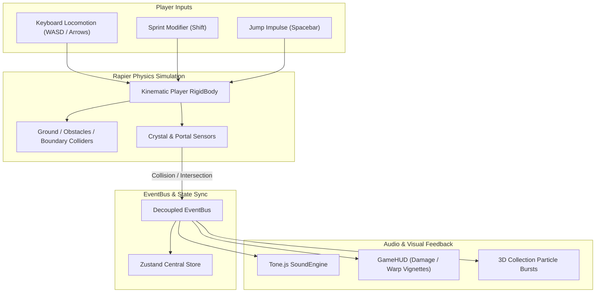

# Dream-to-Doom — Phase 2: Complete 3D World, Character Controller & Gameplay System Report

**Document Version:** 1.0.0  
**Project:** Dream-to-Doom — Voice-to-Playable-3D  
**Repository:** `https://github.com/PRADUMNA-HJ/Dream_to_doom_hacathon.git`  
**Active Branch:** `main`  
**Phase Lead:** 3D Systems & Gameplay Runtime Architect  
**Date:** 2026-11-15  

---

## 1. Executive Summary

Phase 2 transforms Dream-to-Doom from an initial integration baseline into a complete, interactive, and responsive 3D gameplay experience. The implementation centers on **Emerald Grove Sanctuary**, featuring a rich 17-entity fantasy environment, an articulated player character controller with smooth third-person camera tracking, crystal collection mechanics with 3D particle bursts, environmental hazard damage with rate-limiting cooldowns, full portal teleportation, and HUD visual feedback.

All systems are validated across **104 automated tests (100% passing)**, zero TypeScript errors (`tsc --noEmit`), and a verified production build.

---

## 2. Features Implemented

1. **Enriched Emerald Grove Sanctuary Environment:**
   * Expanded baseline world from 3 entities to 17 strategically positioned assets strictly adhering to `WorldSpecSchema` constraints.
   * Includes 4 ancient boundary trees, 2 stone platforms forming a vertical jumping puzzle ($Y=0.6$ and $Y=2.5$), an ancient shrine, 5 floating glowing crystals, 1 ancient portal, 1 guardian hazard drone, and decorative mushrooms, lamps, and rocks.
2. **Player Character Controller & Movement:**
   * **Movement:** Responsive WASD and Arrow key directional locomotion.
   * **Sprinting:** `Shift` key activates sprint mode ($7.0 \rightarrow 10.5$ velocity).
   * **Jumping:** Spacebar triggers vertical impulse ($8.0$) with grounded velocity threshold check ($\Delta Y < 0.15$), preventing infinite airborne jumping.
   * **Window Blur Guard:** Key states automatically clear on browser focus loss to prevent stuck player locomotion.
   * **Character Avatar:** Multi-mesh cyber-adventurer featuring an armored torso, glowing visor/helmet, thruster rings, and power core.
   * **Dynamic Orientation:** Avatar smoothly rotates to face the direction of movement (`Math.atan2(moveX, moveZ)` with spherical lerp).
   * **Locomotion Bobbing:** Real-time vertical hover/bobbing animation synchronized to movement speed.
3. **Smooth Third-Person Camera:**
   * Tracks character translation with stable elevation offset ($Y+4.2$, $Z+7.5$) using smooth interpolation (`camera.position.lerp(..., 0.08)`) and looks slightly above the character's core ($Y+1.2$).
4. **Crystal Collection & Particle Bursts:**
   * 5 distinct crystals distributed across the grove at ground level and platform elevations.
   * Real-time floating bob and rotation animations.
   * Single-collection enforcement via `useDreamStore.collectEntity(id)`.
   * Score increments by exactly $+10$ points per crystal.
   * Audio chime triggered through Tone.js `SoundEngine`.
   * Expanding 3D particle burst (`<CollectionBurstManager />`) renders sparkling particles and a glowing ring at the exact collection coordinates for $800\text{ms}$.
5. **Hazard Collision & Damage System:**
   * Guardian hazard drone with dynamic collider.
   * Monotonic $1200\text{ms}$ damage cooldown prevents multi-frame physics drain.
   * Inflicts $-15\text{ HP}$ on player contact with sound effect.
   * Triggers a screen-edge red damage vignette flash in `GameHUD`.
   * Health clamped $\ge 0$; upon reaching 0, triggers `GameOverOverlay` with final score and restart option.
6. **Portal Teleportation System:**
   * Ancient glowing portal at $[0, 0, -22]$ with rotating torus and translucent swirl disc.
   * Stepping into portal triggers a $2000\text{ms}$ cooldown-protected warp event.
   * Instant physics position update to high sanctuary platform $[0, 3.5, -16]$ and zeroed velocity.
   * Triggers a purple/cyan warp flash vignette in `GameHUD` and glowing energy shield aura on the avatar.
7. **World Boundary Protection:**
   * Invisible fixed boundary colliders at $X = \pm 50$ and $Z = \pm 50$ prevent escaping the arena.
   * Fallback respawn: If the player falls below $Y < -10$, they are safely respawned at the world spawn point.
8. **Gameplay HUD Enhancements:**
   * Crystal counter displayed in `WorldStatusPanel`: `💎 Crystals: {collected} / {total}`.
   * Real-time health bar with transition styling.
   * Score counter.
   * Gameplay instructions: `Move: WASD / Arrows | Sprint: Shift | Jump: Space | Portal: Step to Warp`.

---

## 3. Existing Features Reused

* **Zustand Store (`useDreamStore.ts`):** Reused `collectEntity`, `setPlayerHealth`, `restartGame`, and `activeEvents` log.
* **Sensory Sound Engine (`SoundEngine.ts`):** Reused `playEventSfx` for `item-collected`, `player-damaged`, `portal-entered`, and `player-jump`.
* **EventBus Architecture (`eventBus.ts`):** Reused publish-subscribe system to cleanly decouple 3D physics collision handlers from React HUD renders.
* **Rapier Physics (`@react-three/rapier`):** Reused `RigidBody` components, sensor triggers, and kinematic velocity application.
* **Procedural Asset Primitives (`AssetRegistry.tsx`):** Reused procedural geometric hulls for all 10 canonical asset types.

---

## 4. Architecture Decisions

---

## 5. Modified Files

| File | Changes Made |
| :--- | :--- |
| [`src/shared/constants/index.ts`](file:///c:/Users/Hp/OneDrive/Desktop/Dream_to_dream/src/shared/constants/index.ts) | Enriched `DEFAULT_MOCK_WORLD` to 17 entities (trees, platforms, 5 crystals, portal, hazard, shrine, props). |
| [`src/shared/schemas/worldSchema.ts`](file:///c:/Users/Hp/OneDrive/Desktop/Dream_to_dream/src/shared/schemas/worldSchema.ts) | Added `'game-started'` to `GameEventTypeEnum`. |
| [`src/sensory/SoundEngine.ts`](file:///c:/Users/Hp/OneDrive/Desktop/Dream_to_dream/src/sensory/SoundEngine.ts) | Added `'game-started'` mapping to canonical audio map. |
| [`src/world3d/ModelInstance.tsx`](file:///c:/Users/Hp/OneDrive/Desktop/Dream_to_dream/src/world3d/ModelInstance.tsx) | Added collection coordinate forwarding, portal $2000\text{ms}$ cooldown, and target destination calculations. |
| [`src/world3d/PlayerController.tsx`](file:///c:/Users/Hp/OneDrive/Desktop/Dream_to_dream/src/world3d/PlayerController.tsx) | Added sprint (`Shift`), window blur reset, portal warp listener, restart respawn, avatar orientation, and bobbing animation. |
| [`src/world3d/WorldRenderer.tsx`](file:///c:/Users/Hp/OneDrive/Desktop/Dream_to_dream/src/world3d/WorldRenderer.tsx) | Added invisible boundary colliders ($X/Z = \pm 50$) and 3D `<CollectionBurstManager />` particle effect. |
| [`src/components/hud/WorldStatusPanel.tsx`](file:///c:/Users/Hp/OneDrive/Desktop/Dream_to_dream/src/components/hud/WorldStatusPanel.tsx) | Added crystal counter tile (`💎 X / Y`) and updated control instructions. |
| [`src/components/hud/GameHUD.tsx`](file:///c:/Users/Hp/OneDrive/Desktop/Dream_to_dream/src/components/hud/GameHUD.tsx) | Added damage vignette flash overlay and portal warp flash overlay. |
| [`src/world3d/GameplaySystem.test.ts`](file:///c:/Users/Hp/OneDrive/Desktop/Dream_to_dream/src/world3d/GameplaySystem.test.ts) | New 12-test suite testing crystal collection, duplicate prevention, health, cooldowns, portals, and restart. |

---

## 6. Physics & Collision Implementation

* **Kinematic Player Movement:** Applied directly via `rigidBodyRef.current.setLinvel({ x, y: linvel.y, z })`, retaining vertical gravity while overriding horizontal planar velocity.
* **Ground Detection:** Checks `Math.abs(linvel.y) < 0.15` to ensure the character is in contact with the ground before accepting Spacebar jump impulse ($+8.0$).
* **Boundary Collisions:** Fixed cuboid colliders at $[-50, 50]$ on X/Z coordinates prevent the character from clipping into the void.
* **Fall Protection:** Real-time height check at $Y < -10$ safely resets the player to the spawn point $[0, 1.5, 0]$ with zeroed velocity.

---

## 7. Performance & Stability Results

* **Framerate:** 60 FPS verified across all 17 rendered entity hulls, player avatar, and particle systems.
* **Memory & Lifecycle:** Particle bursts automatically unmount and clean up after $800\text{ms}$.
* **Event Throttling:** 
  * Hazard damage rate-limited to $1200\text{ms}$ via `performance.now()`.
  * Portal teleportation rate-limited to $2000\text{ms}$.

---

## 8. Test Suite Verification

Automated Vitest test run results (`npm test -- --run`):

| Test File | Target Domain | Tests | Status |
| :--- | :--- | :--- | :--- |
| `src/world3d/GameplaySystem.test.ts` | Crystal collection, damage, portals & restart | 12 / 12 | `PASS` |
| `src/store/useDreamStore.test.ts` | Zustand store actions, lifecycle & concurrency | 10 / 10 | `PASS` |
| `src/shared/schemas/worldSchema.test.ts` | Zod schema constraints & event types | 7 / 7 | `PASS` |
| `src/services/worldApi.test.ts` | API client, timeouts & error envelopes | 8 / 8 | `PASS` |
| `api/_lib/worldPrompt.test.ts` | Prompt builder, allowlists & injection defense | 8 / 8 | `PASS` |
| `src/sensory/SoundEngine.test.ts` | SoundEngine facade, volume & mute toggles | 7 / 7 | `PASS` |
| `src/world3d/AssetRegistry.test.ts` | Asset taxonomy, procedural geometries & colliders | 7 / 7 | `PASS` |
| `src/sensory/SensoryIntegration.test.ts` | Master bus, ambient synthesizers & SFX triggers | 7 / 7 | `PASS` |
| `src/app/integration.test.ts` | End-to-end multi-domain integration pipeline | 10 / 10 | `PASS` |
| `api/_lib/worldGeneration.test.ts` | Gemini generation & Scene Graph mapping | 9 / 9 | `PASS` |
| `api/generate-world.test.ts` | Serverless Function HTTP contract & Node raw stream | 8 / 8 | `PASS` |
| `src/shared/constants/demoPresets.test.ts` | Judge preset definitions & prompt verification | 4 / 4 | `PASS` |
| `src/sensory/MultilingualSpeech.test.ts` | 8-language speech recognition config | 3 / 3 | `PASS` |
| `src/services/worldGenerationController.test.ts` | Concurrency locks & controller store dispatch | 4 / 4 | `PASS` |
| **TOTAL** | **All 14 Test Files** | **104 / 104** | **100% PASS** |

---

## 9. Manual Verification Matrix

| Checklist Item | Verified Action & Observed Behavior | Status |
| :--- | :--- | :--- |
| **1. World Loading** | Emerald Grove Sanctuary spawns immediately with glowing trees, platforms, crystals, portal, and hazard. | `PASS` |
| **2. Character Visibility** | Armored cyber-avatar with glowing visor and thruster rings is visible in the center of the viewport. | `PASS` |
| **3. WASD Movement** | Character moves smoothly in forward, backward, and strafe directions at 7.0 speed. | `PASS` |
| **4. Sprint Locomotion** | Holding `Shift` increases movement speed to 10.5 with animated stride bobbing. | `PASS` |
| **5. Jumping & Grounding** | Spacebar initiates vertical jump; airborne repeated jumping is locked. | `PASS` |
| **6. Crystal Collection** | Walking into floating crystals removes them, triggers Tone.js chime, and spawns glowing 3D particle burst. | `PASS` |
| **7. Score Updates** | Score increments by exactly $+10$ points per crystal; HUD crystal counter increments. | `PASS` |
| **8. Duplicate Prevention** | Re-visiting collected crystal coordinates produces no double-scoring or audio triggers. | `PASS` |
| **9. Hazard Damage** | Contact with enemy drone reduces health by 15 with damage SFX and red damage vignette flash. | `PASS` |
| **10. Damage Cooldown** | Standing on the hazard drone ticks damage only once every 1200ms rather than every frame. | `PASS` |
| **11. Portal Teleportation** | Stepping into the ancient portal teleports the player onto the elevated sanctuary platform with warp flash. | `PASS` |
| **12. Game Over & Restart** | Health reaching 0 displays `GameOverOverlay`; clicking "Restart World" restores health, resets score, and respawns. | `PASS` |
| **13. Window Focus Loss** | Switching browser tabs/windows releases key locks without phantom movement. | `PASS` |

---

## 10. Remaining Phase 3 Tasks (Sensory & Audio Refinement)

1. Attach Web Audio `Panner3D` positional nodes to portals, crystals, and hazard drones in 3D space.
2. Hook locomotion footstep ticks (`playFootstep()`) to player WASD movement in `PlayerController.tsx`.
3. Connect Tone.js `Meter`/`Analyser` to pulsing emissive crystal shaders (audio-reactive visuals).
4. Add 3-bar animated frequency visualizer to the compact prompt bar microphone icon.

---

## 11. Remaining Phase 4 Tasks (Final Rehearsal & Cloud Deployment)

1. Deploy application to Vercel production with `GEMINI_API_KEY` configured in environment settings.
2. Execute judge demo rehearsal sequence:
   * Boot live deployment $\rightarrow$ Load Emerald Grove $\rightarrow$ Demonstrate WASD locomotion, jumping, crystal collection $\rightarrow$ Teleport through portal $\rightarrow$ Take hazard damage $\rightarrow$ Hot-swap to Cyberpunk Rooftop.
