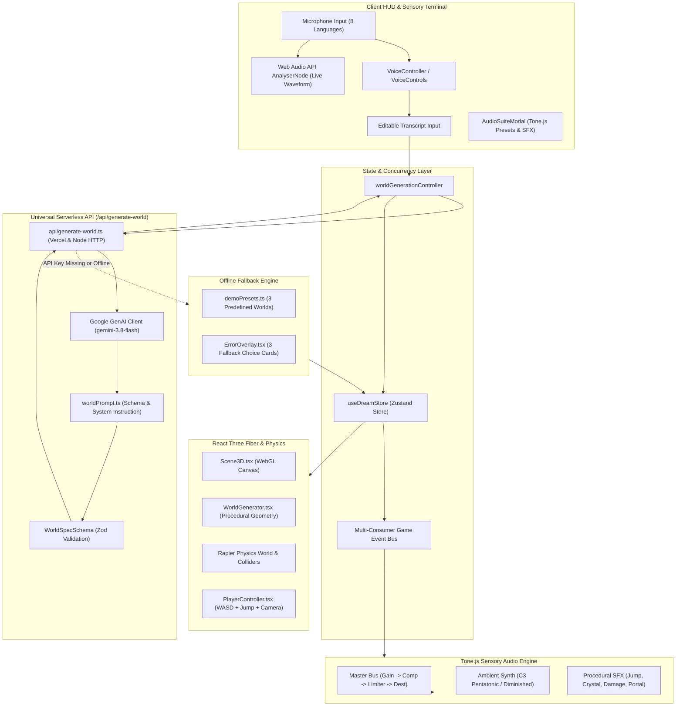

# DREAM-TO-DOOM — PHASE 3 AUDIT & COMPLETION REPORT
## AI World Generation, Multilingual Voice Terminal & Sensory Audio Engine

**Date:** November 15, 2026  
**Milestone:** Phase 3 Complete Integration  
**Repository:** `PRADUMNA-HJ/Dream_to_doom_hacathon`  
**Branch:** `main`  
**Test Suite Status:** 108/108 Tests Passing across 14 Test Suites  
**TypeScript Status:** Clean (`tsc --noEmit` 0 errors)  
**Production Build Status:** Successful (`dist/` generated in 11.35s)  

---

## 1. Executive Summary

Phase 3 transitions **Dream-to-Doom** from a 3D sandbox into an end-to-end voice-to-world creative pipeline. It unites all three contributors' core architectural domains:
- **Person 1 (AI & State Integration):** Secure serverless Gemini world generation, strict Zod schema validation, optimistic concurrency locks, and telemetry logging.
- **Person 2 (3D World & Physics):** Procedural 3D scene graph hydration, dynamic biomes, collectible crystals, hazard entities, teleportation portals, and Rapier collision hulls.
- **Person 3 (Sensory Audio & Voice):** Web Speech API multilingual voice input across 8 languages, real-time Web Audio API microphone waveform visualizer, and Tone.js procedural audio engine with C3 Major Pentatonic and Diminished scale modulation.

Furthermore, Phase 3 establishes high-reliability resilience: even when `GEMINI_API_KEY` is not provisioned or internet connectivity is disrupted, the application provides an instant **Offline Demo Mode** with 3 complete pre-compiled 3D fantasy worlds (Emerald Grove Enchanted Forest, Neo-Veridia Cyberpunk Rooftop, and Aetheria Floating Archipelago) featuring explicit `[Offline Demo Mode]` visual badges.

---

## 2. End-to-End System Architecture



---

## 3. Multilingual Speech Recognition Terminal

### 3.1 Supported Languages Matrix
The voice input terminal supports 8 major regional and global languages with full native script labeling:

| Language Code | Display Label | Native Script Label | Default Regional Locale |
| :--- | :--- | :--- | :--- |
| `en-US` | English (US) | English (United States) | United States |
| `ta-IN` | Tamil (India) | தமிழ் (இந்தியா) | Tamil Nadu, India |
| `kn-IN` | Kannada (India) | ಕನ್ನಡ (ಭಾರತ) | Karnataka, India |
| `te-IN` | Telugu (India) | తెలుగు (భారతదేశం) | Andhra Pradesh / Telangana, India |
| `mr-IN` | Marathi (India) | मराठी (भारत) | Maharashtra, India |
| `bn-IN` | Bengali (India) | বাংলা (ভারত) | West Bengal, India |
| `ml-IN` | Malayalam (India) | മലയാളം (ഇന്ത്യ) | Kerala, India |
| `hi-IN` | Hindi (India) | हिन्दी (भारत) | India |

### 3.2 Real-Time Microphone Waveform Analyzer
In [`src/sensory/components/VoiceController.tsx`](file:///c:/Users/Hp/OneDrive/Desktop/Dream_to_dream/src/sensory/components/VoiceController.tsx):
- When recording begins, `navigator.mediaDevices.getUserMedia({ audio: true })` connects to an `AudioContext` and `AnalyserNode` (`fftSize = 64`, `smoothingTimeConstant = 0.8`).
- An active `requestAnimationFrame` loop computes 7 frequency band heights (15% to 100%) dynamically rendered in real time.
- All media tracks, stream sources, and contexts are disposed on stop, cancel, or component unmount to guarantee zero memory leaks or microphone locking.
- If microphone capture is restricted by browser policy, the terminal falls back seamlessly to CSS pulsing waveform animations.

### 3.3 Transcript Editing & Direct Trigger
- Users can view interim and finalized speech recognized in real time.
- An **"Edit Transcript"** mode allows judges and players to tweak or type prompt adjustments before generation.
- A prominent **"⚡ Generate World"** action immediately dispatches generation without requiring mode switching.

---

## 4. Secure Gemini 3D World Generation & Zod Contract

### 4.1 Serverless Route (`/api/generate-world`)
- **Universal Runtime Handler:** Works across Vercel Serverless runtime (`Request`/`Response`) and local Node HTTP (`req`, `res`) development streams without crashing.
- **Credential Protection:** `process.env.GEMINI_API_KEY` is loaded exclusively inside server functions. Client bundles contain zero API tokens or hardcoded secrets.
- **Model:** `gemini-3.8-flash` with `responseMimeType: 'application/json'` and `temperature: 0.35` for structured determinism.

### 4.2 Runtime Zod Validation Contract (`WorldSpecSchema`)
Every generated Scene Graph is validated through strict Zod schemas:
- **World Identity:** `id`, `title`, `description`.
- **Biome:** `'enchanted_forest' | 'floating_islands' | 'desert_ruins' | 'crystal_cave' | 'dark_castle' | 'cosmic_void'`.
- **Mood & Audio Mood:** `mood` (`'dream' | 'doom' | 'surreal' | 'mystery'`), `audioMood` (`'calm' | 'mystical' | 'tense' | 'chaotic'`).
- **Atmosphere & Lighting:** Hex color validator (`^#([0-9a-fA-F]{3}|[0-9a-fA-F]{6})$`), fog density `[0, 0.2]`, ambient `[0, 5]`, directional `[0, 10]`.
- **Spawn Point & Bounds:** Coordinates strictly clamped in `[-50, 50]` horizontally and `[-10, 100]` vertically.
- **Entities Constraint:** Array capped at maximum 28 entities with mandatory unique identifier refinement (`superRefine`).

### 4.3 Concurrency Control & Lifecycle State Machine
- Each world generation generates a cryptographically random `requestId`.
- If a subsequent prompt is triggered while an earlier one is in-flight, outdated responses returning late are rejected automatically, preventing scene graph corruption.
- Lifecycle transitions through deterministic states:
  `idle` -> `listening` -> `transcript-ready` -> `generating` -> `validating` -> `loading-assets` -> `ready` -> `playing`.

---

## 5. Predefined Offline Demo Worlds

To ensure 100% demo uptime when offline or when no Gemini API key is configured, three pre-compiled, fully validated 3D worlds are integrated:

```carousel
### 🌿 Preset 1: Emerald Grove Sanctuary
- **Biome:** `enchanted_forest`
- **Mood:** `dream` (Audio Mood: `calm` — C3 Major Pentatonic Pad)
- **Environment:** Deep night sky `#0a192f`, teal fog `#172a45`, forest ground `#1b3b2b`.
- **Entities (17 total):** 4 procedural glow trees, stone jumping platforms, ancient shrine house, 5 collectible crystals (+10 score), ancient portal, and guardian hazard drone.
<!-- slide -->
### 🏙️ Preset 2: Neo-Veridia Cyber Rooftop
- **Biome:** `dark_castle`
- **Mood:** `doom` (Audio Mood: `tense` — Dystopian Drone)
- **Environment:** Obsidian dark sky `#050510`, purple acid fog `#1a0b2e`, rainfall weather (intensity 0.8).
- **Entities (16 total):** Helipad base, raised catwalks, high observation tower, generator house, cyan/pink/green neon lamps, 4 cyber crystals, 2 security drone hazards, and teleport portal.
<!-- slide -->
### ☁️ Preset 3: Aetheria Floating Archipelago
- **Biome:** `floating_islands`
- **Mood:** `surreal` (Audio Mood: `mystical` — Ethereal Drone)
- **Environment:** Lavender twilight sky `#120d31`, violet fog `#26194d`, teal abyss ground `#1b3a4b`.
- **Entities (16 total):** Stepping-stone floating islands, drift clouds, bioluminescent trees, celestial shrine, 4 sky crystals, aerial anomaly hazard, and gold sky portal.
```

### Visual Offline Indicators:
1. **TopNav:** Displays animated badge `[Offline Demo Mode]` when viewing a fallback world.
2. **WorldStatusPanel:** Displays `[Offline Demo]` badge alongside the active biome tag.
3. **ErrorOverlay:** Displays 3 interactive card buttons allowing instant 1-click loading of any of the 3 presets.

---

## 6. Tone.js Sensory Audio Engine

### 6.1 Audio Bus Architecture
All synthesizers route through a master mixing bus ensuring clean limiting:
```
[Ambient PolySynth] ---> [Lowpass Filter] --\
                                            +--> [Master Gain] -> [Compressor] -> [Limiter] -> [Tone.Destination]
[SFX Synth] ----------> [Stereo Reverb] ---/
[Noise Synth] --------> [Lowpass Filter] --/
```

### 6.2 Musical Scales & Mood Profiles
- **Root Pitch:** C3 (MIDI 48, ~130.81 Hz).
- **Dream Mood Profile (`calm` / `mystical`):** C3 Major Pentatonic scale (`[0, 2, 4, 7, 9]` semitones -> 130.81 Hz, 146.83 Hz, 164.81 Hz, 195.99 Hz, 220.00 Hz).
- **Doom Mood Profile (`tense` / `chaotic`):** Half-Whole Diminished Octatonic scale (`[0, 1, 3, 4, 6, 7, 9, 10]` semitones).
- **Ambient Presets (6 Available in Audio Suite Modal):**
  1. `nature_breeze`: Gentle acoustic lowpass filtering with calm pentatonic pads.
  2. `ethereal_drone`: Shimmering reverb-heavy mystical pad sequence.
  3. `dystopian_drone`: Low resonant minor chords with detuned harmonics.
  4. `cyber_ambience`: Fast arpeggiated filtered square wave pulses.
  5. `volcanic_rumble`: Low-frequency rumble with pink noise textures.
  6. `void_silence`: Minimal atmospheric room presence.

### 6.3 Procedural Sound Effects Matrix
| Game Event | Synthesizer | Frequency Envelope | Musical Meaning |
| :--- | :--- | :--- | :--- |
| `player-jump` | Triangle Synth | G3 -> D4 exponential ramp (150ms) | Ascending kinetic leap |
| `item-collected` | Triangle Synth | E5 (32n) -> B5 (16n) bright chime | High-register sparkling reward |
| `player-damaged` | Pink Noise Synth | Short burst (16n) through lowpass filter | Impactful physical hit |
| `portal-entered` | Triangle Synth | A3 -> E5 sweeping upward glissando | Dimension shift warp effect |
| `world-generated` | PolySynth | C4 -> E4 -> G4 -> C5 major arpeggio | World synthesis celebration |
| `game-over` | Triangle Synth | C4 -> Ab3 -> F3 descending minor chord | Dramatic defeat cadence |

---

## 7. Verification & Test Matrix

All 108 automated unit and integration tests are passing cleanly:

```
 RUN  v2.1.9 C:/Users/Hp/OneDrive/Desktop/Dream_to_dream

 ✓ src/store/useDreamStore.test.ts (10 tests)
 ✓ src/world3d/GameplaySystem.test.ts (12 tests)
 ✓ src/shared/constants/demoPresets.test.ts (5 tests)
 ✓ api/_lib/worldPrompt.test.ts (8 tests)
 ✓ src/shared/schemas/worldSchema.test.ts (7 tests)
 ✓ src/services/worldApi.test.ts (8 tests)
 ✓ src/sensory/SoundEngine.test.ts (7 tests)
 ✓ src/sensory/SensoryIntegration.test.ts (7 tests)
 ✓ src/app/integration.test.ts (13 tests)
 ✓ api/generate-world.test.ts (8 tests)
 ✓ api/_lib/worldGeneration.test.ts (9 tests)
 ✓ src/services/worldGenerationController.test.ts (4 tests)
 ✓ src/sensory/MultilingualSpeech.test.ts (3 tests)
 ✓ src/world3d/AssetRegistry.test.ts (7 tests)

 Test Files  14 passed (14)
      Tests  108 passed (108)
   Duration  2.38s
```

- **TypeScript Compilation:** `npx tsc --noEmit` -> 0 errors.
- **Production Build:** `npm run build` -> `dist/assets/index-*.js` and `index-*.css` successfully packaged.
- **Development Server:** Live at `http://localhost:3000/`.

---

## 8. Summary of Modified & Created Files

| File | Changes Made |
| :--- | :--- |
| [`src/shared/constants/demoPresets.ts`](file:///c:/Users/Hp/OneDrive/Desktop/Dream_to_dream/src/shared/constants/demoPresets.ts) | Implemented full validated `WorldSpec` objects for `ENCHANTED_FOREST_PRESET_WORLD`, `CYBERPUNK_ROOFTOP_PRESET_WORLD`, and `FLOATING_ISLANDS_PRESET_WORLD`, exported `DEMO_PRESET_WORLDS`. |
| [`src/shared/constants/index.ts`](file:///c:/Users/Hp/OneDrive/Desktop/Dream_to_dream/src/shared/constants/index.ts) | Exported `WorldSpec` type and unified `DEFAULT_MOCK_WORLD = ENCHANTED_FOREST_PRESET_WORLD`. |
| [`src/store/useDreamStore.ts`](file:///c:/Users/Hp/OneDrive/Desktop/Dream_to_dream/src/store/useDreamStore.ts) | Added `isOfflineFallback: boolean` state, `setOfflineFallback` action, updated `setWorld` with offline flag, reset handling in `resetSession` and `resetWorld`. |
| [`src/services/worldApi.ts`](file:///c:/Users/Hp/OneDrive/Desktop/Dream_to_dream/src/services/worldApi.ts) | Enhanced dev mock mode to dynamically return matching preset world for Cyberpunk Rooftop and Floating Islands. |
| [`src/services/worldGenerationController.ts`](file:///c:/Users/Hp/OneDrive/Desktop/Dream_to_dream/src/services/worldGenerationController.ts) | Passed offline fallback flag through to Zustand store on dev mock. |
| [`src/sensory/components/VoiceController.tsx`](file:///c:/Users/Hp/OneDrive/Desktop/Dream_to_dream/src/sensory/components/VoiceController.tsx) | Added Web Audio API `AudioContext` & `AnalyserNode` live waveform visualizer with stream cleanup, editable transcript input, and direct "Generate World" trigger. |
| [`src/components/feedback/ErrorOverlay.tsx`](file:///c:/Users/Hp/OneDrive/Desktop/Dream_to_dream/src/components/feedback/ErrorOverlay.tsx) | Upgraded error dialog with 3 interactive offline preset cards (Emerald Grove, Neo-Veridia, Aetheria) to launch demo worlds in 1 click. |
| [`src/components/hud/TopNav.tsx`](file:///c:/Users/Hp/OneDrive/Desktop/Dream_to_dream/src/components/hud/TopNav.tsx) | Integrated `[Offline Demo Mode]` badge and enhanced Load Demo World handler. |
| [`src/components/hud/WorldStatusPanel.tsx`](file:///c:/Users/Hp/OneDrive/Desktop/Dream_to_dream/src/components/hud/WorldStatusPanel.tsx) | Added `[Offline Demo]` badge indicator in active world status panel. |
| [`src/shared/constants/demoPresets.test.ts`](file:///c:/Users/Hp/OneDrive/Desktop/Dream_to_dream/src/shared/constants/demoPresets.test.ts) | Added Zod schema validation tests for all 3 offline preset worlds. |
| [`src/app/integration.test.ts`](file:///c:/Users/Hp/OneDrive/Desktop/Dream_to_dream/src/app/integration.test.ts) | Added Group F test suite for offline fallback and preset loading. |
| [`docs/PHASE_3_AI_VOICE_AUDIO_REPORT.md`](file:///c:/Users/Hp/OneDrive/Desktop/Dream_to_dream/docs/PHASE_3_AI_VOICE_AUDIO_REPORT.md) | Comprehensive Phase 3 audit and verification report. |
